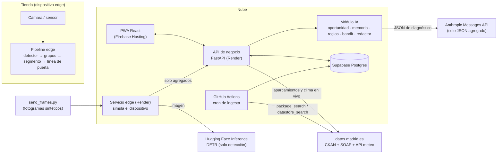
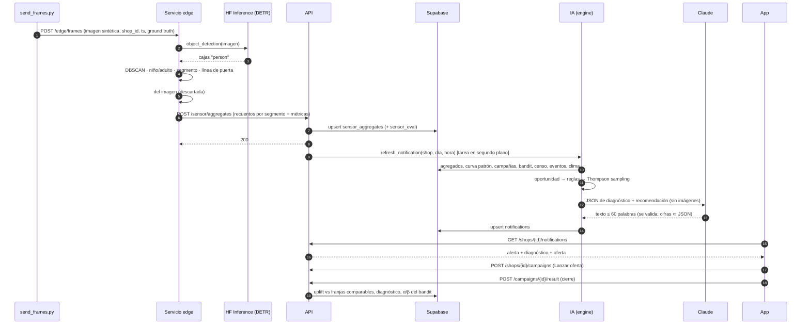

# Hora Valle + Efecto Sombra — Arquitectura

Reto #31 · Cátedras Telefónica (Madrid) · Prototipo · Octubre 2026

---

## 1. Visión general y problema

Los pequeños comercios de Madrid ven pasar mucha gente que no entra. No saben **cuándo**
se les escapa, **quién** (persona sola, pareja, familia, grupo de amigos…) ni **qué oferta**
encajaría con ese público. Una promo genérica falla a menudo por razones evitables: un
**2x1 no sirve si la mayoría de los grupos son de 3 personas**, porque alguien se queda fuera.

La plataforma:

1. **Mide** con un sensor en la puerta (cámara + detector en el propio dispositivo) cuántos
   grupos pasan y cuántos entran, por franja horaria y por **tipo de grupo**, sin guardar
   imágenes ni identificar a nadie.
2. **Contextualiza** con datos reales de la ciudad (datos.madrid.es): curva patrón de
   peatones de la estación de aforo más cercana, competencia del Censo de locales,
   eventos, aparcamientos y clima.
3. **Detecta la oportunidad perdida** (gente que pasa y no entra, en €) y el **Efecto Sombra**
   (flujo de la calle principal que no llega a la calle lateral).
4. **Aprende** qué promociones funcionaron, medidas como *uplift* frente a franjas comparables
   sin promo, y **explica por qué** con reglas legibles.
5. **Recomienda y avisa** al comerciante con una oferta adaptada al público real de esa franja.

Nombres de vistas alineados con el prototipo de Figma (marca *atravia*): «Tu calle, hoy»
(Inicio), «Una tarde por aprovechar» (Detalle), «Una oferta para todos» (Alertas),
«Tu comercio» (Perfil) y «Aprendizajes». Además hay una vista «Sensor demo».

## 2. Diagrama de bloques



| Bloque | Qué hace |
|---|---|
| **App (`/web`)** | PWA móvil. Curva del día por segmento y franjas de pérdida, detalle de oportunidad, alerta con botón «Lanzar oferta», perfil (aforo, público, descuento máximo, ofertas vetadas), aprendizajes y sensor demo. Nunca habla con la BD directamente. |
| **API (`/api`)** | FastAPI con OpenAPI (`/docs`). Routers `madrid`, `sensor`, `shops`, `campaigns`, `ai`. Recibe agregados, calcula oportunidades, cierra campañas (uplift + reglas + bandit) y genera notificaciones. |
| **Sensor / edge (`/edge`)** | Código del dispositivo: `Detector` (DETR hoy, YOLO mañana), DBSCAN, niño/adulto, segmento, línea de la puerta, `age_band` enchufable (desactivado). En el prototipo corre como servicio aparte en Render; **es el único que ve imágenes**. |
| **IA (`/ai`)** | Funciones puras y testeadas: `opportunity` (pérdida en € y Efecto Sombra), `memory` (contexto y uplift), `rules` + `rules.yaml`, `bandit` + `offers.yaml`, `redactor` (Claude o plantilla), `engine` (orquesta el JSON). |
| **BD (`/db`)** | Postgres en Supabase. Tablas `madrid_*` (reales, con procedencia), tablas del comercio con `synthetic` obligatorio. RLS activado sin políticas: solo la API (rol `postgres`) accede. |
| **Ingesta (`/ingest`)** | Conectores CKAN que descubren datasets y recursos en tiempo de ejecución, verifican cada recurso con una petición real y cargan con procedencia. Ejecutados por GitHub Actions. |
| **datos.madrid.es** | Fuente de los datos de ciudad (ver §5). |

## 3. Flujo de datos

**Origen → procesamiento → almacenamiento → visualización/acción**

| Origen | Procesamiento | Almacenamiento | Uso |
|---|---|---|---|
| Aforos peatonales (CKAN) | Normalización (mojibake, coordenadas con puntos de miles), 2 últimos trimestres con datos, curva media/p30/p70 por estación × día × hora | `madrid_stations`, `madrid_ped_counts`, `madrid_ped_patterns` | Línea de la curva del día; pico de la calle; Efecto Sombra |
| Censo de locales y terrazas | UTM ETRS89 30N → WGS84 (pyproj); solo abiertos con puerta a calle | `madrid_shops`, `madrid_terraces` | Elegir comercios reales; competencia directa en 100 m |
| Agenda | Fechas y coordenadas | `madrid_events` | Evento cercano en el contexto de la campaña |
| Clima horario + acumulado 30 días | Matriz H01..H24 con validación V/N | `madrid_weather_*` | Calor/lluvia en el contexto; regla de causa externa |
| Aparcamientos (SOAP en vivo) | Parseo XML + emparejado con plazas del inventario | Caché en memoria (60 s) | Indicador de llegada de gente |
| Fotogramas de cámara | Detección → grupos → segmento → puerta → **descarte de la imagen** | `sensor_aggregates` (recuentos) | Oportunidad, contexto, notificación |
| Comercio (sintético) | Tickets, campañas, resultados | `tickets`, `campaigns`, `campaign_results`, `bandit_arms` | Uplift, reglas, bandit, aprendizajes |



## 4. Lógica principal de la IA

### 4.1 Pipeline del sensor (edge)

```text
dets   = detector.detect(imagen)                 # solo label == "person", umbral configurable
pies   = [(centro_x(caja), borde_inferior(caja)) for caja in dets]
eps    = 0.6 × mediana(altura de las cajas)      # escala con la perspectiva
grupos = DBSCAN(pies, eps, min_samples=1)
para cada grupo:
    para cada persona p:
        pares = personas del grupo con |pie_y − p.pie_y| ≤ 0.25 × altura
        adultos_ref = {q ∈ pares : altura(q) ≥ 0.65 × max(altura(pares))}
        niño(p) = altura(p) < 0.65 × mediana(altura(adultos_ref))
    segmento = f(adultos, niños)   # solo, dos_adultos, adulto_con_ninos,
                                   # familia_numerosa (≥3 niños), grupo_adultos_3_6, grupo_grande
    entra    = punto_de_apoyo_medio en el lado interior de la línea de la puerta
agregados[segmento] += {grupos_pasan|entran, personas, grupos_impares}
del imagen ; POST agregados
```

### 4.2 Detector de oportunidad perdida y Efecto Sombra

```text
para cada (hora h, segmento s):
    expuestos  = grupos que pasan por delante (incluye los que entran)
    potencial  = expuestos × conversion_ref[s]          # p. ej. 1,25 × conversión sin promo
    perdida_€  = max(0, potencial − entran) × ticket_medio[s]

Efecto Sombra (comercio en calle lateral):
    principal[h] = curva patrón REAL de la estación de la calle principal (mismo día de la semana)
    lateral[h]   = personas medidas por el sensor en la lateral
    ratio_ref    = p70( lateral[h] / principal[h] )       # lo que la lateral capta en buenas horas
    para h en horas pico de la principal (≥ p70):
        déficit[h] = max(0, principal[h] × ratio_ref − lateral[h])
```

### 4.3 Memoria de campañas y éxito

Cada campaña guarda su contexto: franja, día, hora de inicio y fin, segmento dominante y su
cuota, cuota de grupos impares (paridad), hora pico de la calle, evento cercano, clima
(T máx. y lluvia de la estación meteorológica municipal más próxima con dato) y nº de competidores
del mismo epígrafe a menos de 100 m (Censo).

```text
promo     = (expuestos, entradas, ventas, compras) en la ventana de la campaña
bases     = misma ventana 1–4 semanas antes SIN campaña activa
uplift    = conversión(promo) / media(conversión(bases)) − 1      # conversión = entradas / expuestos
éxito     = uplift ≥ 10 %          # objetivo de la app: más entradas a igual flujo, no ventas brutas
```

### 4.4 Diagnóstico por reglas (`ai/rules.yaml`, editable)

Orden, umbrales y textos se editan en YAML. Cada regla devuelve `{code, evidence, confidence, text}`.

```text
OFERTA_PARES_GRUPOS_IMPARES  si oferta.requiere_grupo_par y cuota_impares ≥ 0,40
PROMO_TRAS_PICO              si hora_inicio − hora_pico ≥ 1
TICKET_BAJO_CANIBALIZA       si Δentradas ≥ +15 % y Δticket ≤ −15 %
CAUSA_EXTERNA_CLIMA          si T máx ≥ 33 ºC o lluvia ≥ 1 l/m²
COMPETENCIA_ALTA             si competidores del mismo epígrafe en 100 m ≥ 8
confianza = base + fuerza de la evidencia (+ si la campaña fracasó), recortada a [0,05; 0,95]
```

La cuota de grupos impares se calcula **solo entre grupos de 2 o más personas** (quien va
solo no «se queda fuera» de un 2x1).

### 4.5 Recomendador (Thompson sampling)

```text
brazo = (franja, segmento_dominante, tipo_oferta) con Beta(α, β), α = β = 1 al inicio
elegibles = catálogo − vetadas − (descuento > máximo del perfil, salvo excepciones)
                    − (no dirigidas al segmento dominante)
                    − (requiere_grupo_par si cuota_impares ≥ 0,40)
para cada oferta elegible: θ ~ Beta(α, β)
recomendar argmax θ ; devolver también las excluidas con su motivo
al cerrar la campaña: éxito → α += 1 ; fracaso → β += 1
```

### 4.6 Redactor

Recibe **solo** el JSON de `engine.build_payload` (oportunidad, contexto, diagnóstico,
recomendación y lecciones). Usa la Anthropic Messages API (`ANTHROPIC_MODEL`, por defecto
`claude-opus-5-5` con esfuerzo `low` y *fallback* del lado del servidor). Validación: como
máximo 60 palabras, y **toda cifra del texto debe estar en el JSON**. Si no hay clave, si
Claude rechaza la petición o si el texto no pasa la validación, se usa una plantilla
determinista. Las imágenes nunca salen del servicio edge.

## 5. Datasets reales usados (verificados el 15-oct-2026)

Todos los IDs se **redescubren en tiempo de ejecución** (`package_search` → `package_show` →
elección del recurso por su descripción) y se verifican con `datastore_search limit=1`
antes de cargarlos. La tabla es documentación, no configuración.

| Uso | Dataset (id) | Recurso | Acceso | Frecuencia | Limitaciones |
|---|---|---|---|---|---|
| Aforos peatonales permanentes | `300321-0-aforos-peatones-bicicletas` | `300321-0-aforos-peatones-bicicletas-csv` («Aforos peatones. 2024») | datastore / SQL | Trimestral, según metadatos | **El último dato publicado es del 30/06/2024**: se usan T1 y T2 de 2024 → **patrón histórico, no tiempo real**. No hay datos entre ago-2021 y sep-2022. Coordenadas con puntos de miles; texto con mojibake. 30 estaciones (`PERM_PEA02_PM01` Fuencarral 22, `PERM_PEA08_PM01/02` Gran Vía 34/33). |
| Censo de locales: actividades | `200085-0-censo-locales` | `200085-5-censo-locales` («Actividades») | datastore SQL (filtro abiertos + puerta a calle) | Diaria | Las URL de descarga cambian cada día (nombre con fecha): se usa el id del recurso. UTM EPSG:25830. 225.814 filas → 105.980 cargadas. |
| Censo: terrazas | `200085-0-censo-locales` | `200085-6-censo-locales` («Terrazas») | datastore | Diaria | Solo hostelería. |
| Agenda de actividades | `300107-0-agenda-actividades-eventos` | `300107-2-agenda-actividades-eventos-csv` | datastore (alternativa: descarga CSV) | Diaria | Incluye exposiciones de meses: el contexto solo usa eventos puntuales con hora. Solo centros municipales o asociados. |
| Estaciones meteorológicas | `300360-0-meteorologicos-estaciones` | `300360-1-meteorologicos-estaciones-csv` | datastore | Anual | No todas miden lluvia (P-89). |
| Clima horario | `300352-0-meteorologicos-horarios` | `300352-180-meteorologicos-horarios-csv` («Desde 2025») | datastore SQL | Mensual (al cerrar el mes) | El mes en curso no aparece (último dato: 30/09/2026). |
| Clima reciente | `300754-0-meteorologia-tiempo-real-acumula` | JSON `…/meteo_tiemporeal_ult.json` | API ciudadesabiertas | Cada 20 min | Solo ~30 días. |
| Clima en vivo | `300392-0-meteorologia-tiempo-real` | JSON `…/meteo_tiemporeal.json` | API ciudadesabiertas | Cada 20 min | Solo el día en curso. |
| Aparcamientos en tiempo real | `50027-0-aparcamientosocupacionyservicios` | `50027-1-…` → SOAP `InfoParking`, operación `GetListParking` | SOAP (el recurso «API» es una página HTML) | Continua | 75 aparcamientos, **solo 26 informan de plazas libres**. Es un indicador de llegada de gente, no de afluencia peatonal. |
| Plazas de aparcamientos | `300542-0-aparcamientos-municipales` | `300542-0-aparcamientos-municipales-csv` | datastore | Mensual | Se empareja con el SOAP por cercanía (< 120 m). |

## 6. Prototipo frente a producción

| Aspecto | Prototipo (este repo) | Producción |
|---|---|---|
| Dónde se detecta | Servicio *edge* en Render; las imágenes llegan por HTTP desde `send_frames.py` | **En el dispositivo de la tienda, en tiempo real**: YOLO (ONNX/TensorRT) sobre el stream, o un **sensor de profundidad/ToF** que no captura caras. Solo suben agregados por MQTT/HTTPS. |
| Detector | DETR-ResNet-50 vía HF Inference Providers (`hf-inference`) | `YoloEdgeDetector` (misma interfaz `Detector`) |
| Entradas y salidas | Línea de puerta por fotograma (cada imagen es una observación) | *Tracking* (ByteTrack) + cruce de línea para no contar dos veces al mismo grupo |
| Imágenes | Sintéticas (FLUX.1-schnell) o MOT20 (plan B) | Stream en memoria; nunca se graban |
| Clima, aparcamientos | Consultados en vivo con caché | Igual, con histórico propio |
| Aforos | Patrón histórico (último trimestre publicado) | Sensores propios del comercio + aforos cuando se publiquen |
| Notificación | Lista en la app (sondeo cada 15 s) | Web Push / WhatsApp Business con *opt-in* |

## 7. Privacidad, cumplimiento y licencias

- **Privacidad por diseño (art. 25 RGPD):** la imagen solo existe en memoria del proceso edge
  durante la inferencia (`del data`). No se guardan imágenes, recortes ni coordenadas por
  persona. Solo suben recuentos por franja y segmento. No hay reconocimiento facial, ni
  identificadores persistentes, ni atributos sensibles. El rango de edad, si se activa, sería
  corporal, agregado y en el dispositivo.
- **Cámaras y vía pública (LOPDGDD art. 22):** un particular solo puede captar la vía pública
  en la medida imprescindible. En producción: cámara orientada al umbral de la puerta,
  cartel informativo, **evaluación de impacto (EIPD)**, registro de actividades y preferencia
  por sensores ToF/profundidad, que no captan caras. Base jurídica: interés legítimo, con
  ponderación documentada.
- **Reglamento europeo de IA (UE 2024/1689):** no se usa identificación biométrica ni
  categorización biométrica por atributos sensibles (prácticas prohibidas o de alto riesgo).
  Contar y segmentar por tamaño de cuerpo es de riesgo mínimo. Los textos de Claude son de
  uso interno del comerciante e indican que los genera una IA (transparencia, art. 50).
- **Datos de ciudad:** datos.madrid.es (licencia CC BY 4.0; se guarda la procedencia en cada fila).
- **Imágenes de prueba (9):** generadas con `black-forest-labs/FLUX.1-schnell` (Apache-2.0)
  vía HF Inference Providers (proveedor `auto`; FLUX no está en `hf-inference`), **sin personas
  reales**. Limitaciones: el generador falla a veces en el número de personas (por eso hay
  un modo de revisión del ground truth) y las escenas son más limpias que las de una cámara
  real. En producción el mismo pipeline recibiría el stream de la cámara o del sensor de
  profundidad. **Nunca se envían a Claude ni a ningún LLM**: solo al detector de personas.
  Plan B: 20 fotogramas reales de MOT20 (`Lekim89/MOT20`, CC BY-NC-SA 3.0, uso académico),
  que no se versionan en el repositorio.
- **Modelos:** DETR (Apache-2.0) solo para inferencia; no hay entrenamiento ni *fine-tuning*.

## 8. Riesgos y trabajo futuro

| Riesgo | Mitigación / siguiente paso |
|---|---|
| Aforos con 2 años de retraso | Tratarlos como patrón; calibrar con el sensor propio; reingesta automática semanal cuando se publique un trimestre nuevo. |
| Conteo por fotograma (sin tracking) | Tracking en el dispositivo y cruce de línea. |
| Niño/adulto por altura de caja (falla con personas sentadas, carritos o grupos en profundidad) | Comparar solo con el pie a la misma altura (hecho); en el futuro, `age_band` corporal en el dispositivo. |
| `age_band` | Interfaz con stub. Candidato: `NTQAI/pedestrian_age_recognition` (cuerpo entero, Apache-2.0) en ONNX en el dispositivo; hoy no está servido por ningún Inference Provider. |
| Uplift sin grupo de control | Alternar días con y sin promo (*switchback*) y ampliar la muestra antes de generalizar. |
| Arranque en frío del plan gratuito de Render | `send_frames.py` despierta `/health`; en producción, plan de pago o *serverless* con *min instances*. |
| Sesgo del recomendador con pocas pruebas | Prior Beta(1,1) + exploración; se muestra el nº de pruebas y la incertidumbre en la app. |
| Texto del LLM con cifras inventadas | Validador estricto + plantilla de respaldo. |

## Anexo · Registro de decisiones (ADR)

| ADR | Decisión | Alternativa descartada | Motivo |
|---|---|---|---|
| 001 | Edge como servicio separado en Render | Router dentro de la API | Separación real de imágenes y agregados; el código del edge es el del dispositivo. Coste: dos arranques en frío. |
| 002 | Ingesta en GitHub Actions (cron) | Tarea programada de Render | Gratis, trazable; la API no carga datos. |
| 003 | Aparcamientos y clima en vivo con caché | Histórico vía cron | GitHub Actions no ejecuta tareas cada minuto. |
| 004 | Censo filtrado (abiertos + puerta a calle) | Las 226.000 filas | Cabe en el plan gratuito de Supabase y es lo que importa para la competencia. |
| 005 | `psycopg` + `DATABASE_URL` | `supabase-py` (REST) | SQL, transacciones y COPY; RLS cierra la API REST pública. |
| 006 | Claude solo con JSON y validación de cifras | Texto libre | Evita alucinaciones numéricas; las imágenes nunca llegan a un LLM. |
| 007 | Frontend en Firebase Hosting | Vercel | Preferencia del equipo; despliegue por GitHub Actions. |
| 008 | DBSCAN propio en NumPy | scikit-learn | Sin dependencias pesadas en el dispositivo; probado con tests. |
